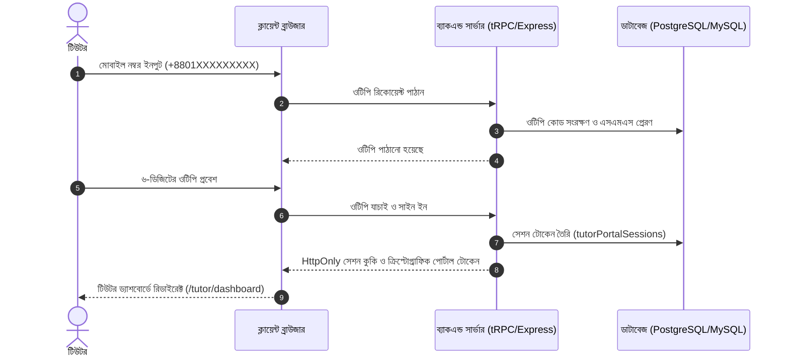
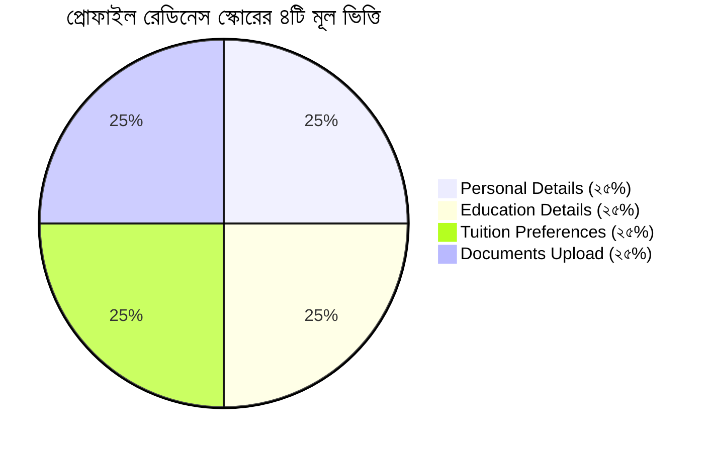
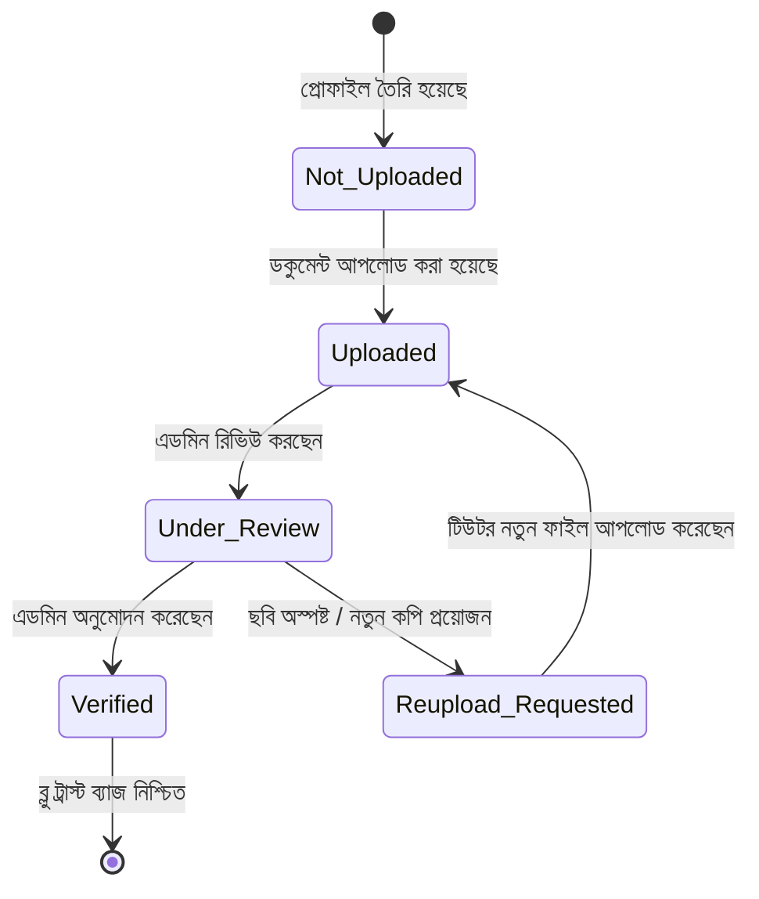

# 👨‍🏫 কানেক্ট টিউটরস (Connect Tutors BD) — টিউটর প্যানেল বিস্তারিত অপারেশন ও আর্কিটেকচার ম্যানুয়াল

> **প্রকল্প:** কানেক্ট টিউটরস বিডি (`connecttutorsbd.com`)  
> **অফিশিয়াল স্বীকৃতি:** **`Member: BTPA - 077`** (Bangladesh Tuition Provider Association)  
> **মডিউল:** টিউটর প্যানেল ও প্রোফাইল ওয়ার্কস্পেস (Tutor Portal & Profile Engine)  
> **ভার্সন:** 1.0.0 (Production Grade)  
> **সর্বশেষ আপডেট:** নভেম্বর ২০২৬  
> **স্ট্যাটাস:** ৪,৫২৫+ টেস্ট ভেরিফাইড ও ১০০% টাইপ-সেফ

---

## সূচিপত্র (Table of Contents)

1. [ভূমিকা ও মূল দর্শন (Introduction & Core Philosophy)](#১-ভূমিকা-ও-মূল-দর্শন)
2. [নিবন্ধন, লগইন ও সেশন ম্যানেজমেন্ট (Registration, Login & Security)](#২-নিবন্ধন-লগইন-ও-সেশন-ম্যানেজমেন্ট)
3. [ড্যাশবোর্ড ওভারভিউ ও প্রধান ন্যাভিগেশন (Dashboard Layout & Navigation)](#৩-ড্যাশবোর্ড-ওভারভিউ-ও-প্রধান-ন্যাভিগেশন)
4. [টিউটর প্রোফাইল ওয়ার্কস্পেস — ৫টি সেকশনের পুঙ্খানুপুঙ্খ বিশ্লেষণ](#৪-টিউটর-প্রোফাইল-ওয়ার্কস্পেস--৫টি-সেকশনের-পুঙ্খানুপুঙ্খ-বিশ্লেষণ)
   - [৪.১ Section A: ব্যক্তিগত তথ্য ও পরিচিতি (Personal Information)](#৪১-section-a-ব্যক্তিগত-তথ্য-ও-পরিচিতি-personal-information)
   - [৪.২ Section B: পারিবারিক বিবরণ (Family Details)](#৪২-section-b-পারিবারিক-বিবরণ-family-details)
   - [৪.৩ Section C: শিক্ষাগত যোগ্যতা ও ফলাফল (Education Details)](#৪৩-section-c-শিক্ষাগত-যোগ্যতা-ও-ফলাফল-education-details)
   - [৪.৪ Section D: শিক্ষাদান দক্ষতা ও টিউশন পছন্দ (Teaching Expertise & Preferences)](#৪৪-section-d-শিক্ষাদান-দক্ষতা-ও-টিউশন-পছন্দ-teaching-expertise--preferences)
   - [৪.৫ Section E: পরিচিতিমূলক বিবরণী ও বায়ো (Introduction & Bio)](#৪৫-section-e-পরিচিতিমূলক-বিবরণী-ও-বায়ো-introduction--bio)
5. [প্রোফাইল প্রস্তুতি স্কোর ও ভেরিফিকেশন চেকলিস্ট (Readiness Score & Checklist)](#৫-প্রোফাইল-প্রস্তুতি-স্কোর-ও-ভেরিফিকেশন-চেকলিস্ট)
6. [ডকুমেন্ট আপলোড ও ভেরিফিকেশন লাইফসাইকেল (Document Verification)](#৬-ডকুমেন্ট-আপলোড-ও-ভেরিফিকেশন-লাইফসাইকেল)
7. [১-পেজ প্রফেশনাল সিভি ও বায়োডাটা PDF জেনারেটর (Tutor CV PDF)](#৭-১-পেজ-প্রফেশনাল-সিভি-ও-বায়োডাটা-pdf-জেনারেটর)
8. [জব বোর্ড, আবেদন ও ম্যাচিং লাইফসাইকেল (Job Board & Applications)](#৮-জব-বোর্ড-আবেদন-ও-ম্যাচিং-লাইফসাইকেল)
9. [অফিসিয়াল নিয়োগ নিশ্চিতকরণ পত্র (Confirmation Letter with QR)](#৯-অফিসিয়াল-নিয়োগ-নিশ্চিতকরণ-পত্র)
10. [লাইভ চ্যাট, ইনবক্স ও কমিউনিকেশন সিস্টেম (Communication & Chat)](#১০-লাইভ-চ্যাট-ইনবক্স-ও-কমিউনিকেশন-সিস্টেম)
11. [সাপ্তাহিক ক্লাস শিডিউল ক্যালেন্ডার (Weekly Schedule Grid)](#১১-সাপ্তাহিক-ক্লাস-শিডিউল-ক্যালেন্ডার)
12. [অ্যাকাউন্ট সেটিংস ও চেঞ্জ রিকোয়েস্ট (Account Settings)](#১২-অ্যাকাউন্ট-সেটিংস-ও-চেঞ্জ-রিকোয়েস্ট)
13. [টেকনিক্যাল আর্কিটেকচার, এপিআই ও ডাটাবেজ মডেল (API & Schema)](#১৩-টেকনিক্যাল-আর্কিটেকচার-এপিআই-ও-ডাটাবেজ-মডেল)

---

## ১. ভূমিকা ও মূল দর্শন

**কানেক্ট টিউটরস বিডি**-এর টিউটর প্যানেল হলো বাংলাদেশের শিক্ষক ও টিউটরদের জন্য তৈরি একটি পেশাদার, স্বয়ংক্রিয় এবং উৎপাদনশীল ডিজিটাল প্ল্যাটফর্ম। এটি কেবল একটি সাধারণ প্রোফাইল পেজ নয়; এটি একজন টিউটরের সম্পূর্ণ টিউশন ক্যারিয়ার পরিচালনার একটি পরিপূর্ণ ইকোসিস্টেম।

### ১.১ প্রধান উদ্দেশ্য ও সুবিধাসমূহ
* **বিশ্বস্ততা ও সম্মান:** প্রতিটি টিউটরকে একটি ইউনিক টিউটর আইডি (যেমন: `Tutor ID: CT-1042`) প্রদান করা হয়। জাতীয় পরিচয়পত্র ও বিশ্ববিদ্যালয় আইডি যাচাইয়ের মাধ্যমে অভিভাবক মহলে সর্বোচ্চ বিশ্বাসযোগ্যতা নিশ্চিত করা হয়।
* **১-ক্লিক প্রোডাক্টিভিটি:** মোবাইল বা কম্পিউটার থেকে অতি দ্রুত উপযুক্ত টিউশন খুঁজে আবেদন করা, এক ক্লিকে অফিশিয়াল লেটারহেড সম্বলিত এ৪ সিভি/বায়োডাটা PDF তৈরি করা এবং আবেদনের প্রতিটি ধাপ ট্র্যাক করা।
* **সঠিক বিষয়ে সঠিক শিক্ষক:** টিউটরের অধ্যয়নের বিভাগ (যেমন: CSE, Mathematics, EEE, Medical, English, Business ইত্যাদি) স্বয়ংক্রিয়ভাবে ডিটেক্ট করে টিউশন এক্সপার্টাইজ সিলেক্টরে বিষয়গুলোকে শীর্ষে নিয়ে আসা ও `"Recommended"` ব্যাজ প্রদর্শন।
* **বাস্তবসম্মত সুরক্ষা:** ডামি তথ্য, অবাস্তব অভিজ্ঞতা দাবি বা অসম্পূর্ণ ঠিকানা প্রতিহত করার জন্য সেন্ট্রালাইজড ভ্যালিডেশন গার্ডস।

---

## ২. নিবন্ধন, লগইন ও সেশন ম্যানেজমেন্ট

টিউটর প্যানেলের নিরাপত্তা ও অনবোর্ডিং ফ্লো অত্যন্ত মসৃণ এবং আধুনিক সিকিউরিটি স্ট্যান্ডার্ড মেনে ডিজাইন করা হয়েছে:



### ২.১ প্রাথমিক অনবোর্ডিং ও রেজিস্ট্রেশন
* **রুট:** `/become-tutor` বা `/join-tutor`
* **ড্রাফট অটো-রিকভারি:** টিউটর ফর্ম পূরণের মাঝপথে ব্রাউজার বন্ধ করলেও লোকাল ড্রাফট মেমোরি (`readTutorOnboardingDraft`) ডাটা সংরক্ষণ করে রাখে।
* **ফোন নম্বর নরম্যালাইজেশন:** বাংলাদেশি যেকোনো ফরম্যাটের নম্বর (`017...`, `+88017...`, `88017...`) স্বয়ংক্রিয়ভাবে আন্তর্জাতিক স্ট্যান্ডার্ড ফরম্যাট `+8801XXXXXXXXX`-এ রূপান্তরিত হয়।

### ২.২ পোর্টাল সেশন সিকিউরিটি (`tutorPortalSessions`)
* **দ্বৈত নিরাপত্তা স্তর:** ক্লায়েন্ট সেশনে শুধু সাধারণ কুকি যথেষ্ট নয়; প্রতিটি টিউটর সেশনের জন্য একটি ক্রিপ্টোগ্রাফিক পোর্টাল প্রুফ টোকেন যাচাই করা হয়।
* **গ্লোবাল লগআউট ব্রডকাস্ট:** কোনো ডিভাইসে সাইন আউট করা হলে `subscribeToTutorPortalGlobalLogout`-এর মাধ্যমে অন্য সকল ব্রাউজার ট্যাবে স্বয়ংক্রিয়ভাবে নিরাপদ সাইন আউট কার্যকর হয়।
* **আন-সেভড চেঞ্জ প্রটেকশন (`onDirtyChange`):** প্রোফাইল এডিট করার সময় কোনো তথ্য সেভ না করে অন্য ট্যাবে যাওয়ার চেষ্টা করলে ব্রাউজার কনফার্মেশন অ্যালার্ট দেয় যাতে টিউটরের পরিশ্রম বৃথা না যায়।

---

## ৩. ড্যাশবোর্ড ওভারভিউ ও প্রধান ন্যাভিগেশন

টিউটর ড্যাশবোর্ডের লেআউটটি ডেস্কটপ ও মোবাইল উভয় স্ক্রিনেই স্বাচ্ছন্দ্যে ব্যবহারের জন্য অপটিমাইজড:

```text
/tutor/dashboard
 ├── 1. Dashboard (সারসংক্ষেপ, স্টেজ ন্যাভ, প্রোফাইল প্রগ্রেস)
 ├── 2. Job Board (লাইভ টিউশন তালিকা ও ফিল্টারিং)
 ├── 3. Advance Matching Jobs (যোগ্যতার সাথে মিলে যাওয়া টিউশন)
 ├── 4. Status (আবেদনকৃত টিউশনের টাইমলাইন ও স্ট্যাটাস)
 ├── 5. Profile (৫-সেকশন প্রোফাইল ফর্ম ও রেডিনেস চেকলিস্ট)
 ├── 6. Confirmation Letter (অফিসিয়াল নিয়োগপত্র ও কিউআর যাচাই)
 ├── 7. Payment (টিউশন ফি ও সেটেলমেন্ট রেকর্ড)
 ├── 8. Notifications (রিয়েল-টাইম নোটিফিকেশন ইনবক্স)
 ├── 9. Live Chat (এডমিন ও কো-অর্ডিনেটরের সাথে চ্যাট)
 ├── 10. How It Works (অডিও-ভিজ্যুয়াল প্লেয়ার গাইড)
 ├── 11. Join our Community (অফিসিয়াল গ্রুপ ও ফোরাম)
 ├── 12. Install App (মোবাইলে PWA হোমস্ক্রিন শর্টকাট)
 ├── 13. Settings (পাসওয়ার্ড, গোপনীয়তা ও চেঞ্জ রিকোয়েস্ট)
 └── 14. Sign Out (নিরাপদ সেশন সমাপ্তি)
```

### ৩.১ সাইডবার আইডেন্টিটি কার্ড
ড্যাশবোর্ডের বাম সাইডবারে টিউটরের একটি আকর্ষণীয় আইডেন্টিটি কার্ড প্রদর্শিত হয়:
* **প্রোফাইল ছবি:** বৃত্তাকার প্রিমিয়াম অ্যাভাটার।
* **টিউটর নাম ও ইমেইল:** যাচাইকৃত নাম ও প্রাইমারি ইমেইল।
* **টিউটর আইডি:** অফিশিয়াল সিরিয়াল (যেমন: `Tutor ID: CT-1042`)।
* **যোগদানের তারিখ:** `Joined Aug 25, 2026` ফরম্যাটে প্রদর্শিত।

---

## ৪. টিউটর প্রোফাইল ওয়ার্কস্পেস — ৫টি সেকশনের পুঙ্খানুপুঙ্খ বিশ্লেষণ

টিউটর প্রোফাইলটি ৫টি স্বতন্ত্র সেকশনে সুবিন্যস্ত, যা টিউটরের শিক্ষাগত ব্যাকগ্রাউন্ড, অভিজ্ঞতা এবং দক্ষতার একটি স্বচ্ছ ও বিশ্বাসযোগ্য চিত্র অভিভাবকদের কাছে উপস্থাপন করে:

---

### ৪.১ Section A: ব্যক্তিগত তথ্য ও পরিচিতি (Personal Information)

| ফিল্ডের নাম | ফিল্ডের ধরন | ভ্যালিডেশন ও নিরাপত্তা রুলস | উদ্দেশ্য ও কার্যকারিতা |
|---|---|---|---|
| **প্রোফাইল ছবি (Photo)** | ফাইল আপলোড ও ক্রপ | স্কয়ার ফরম্যাট, সর্বোচ্চ সাইজ লিমিট, `react-easy-crop` | শিক্ষকসুলভ মার্জিত প্রোফাইল ছবি নিশ্চিতকরণ। |
| **প্রফেশনাল হেডলাইন** | টেক্সট ইনপুট | ন্যূনতম ১০ ক্যারেক্টার, পুনরাবৃত্তিমূলক শব্দ (যেমন: "tutor tutor") রোধ | প্রোফাইল কার্ড ও সিভি-তে ১-লাইনে টিউটরের মূল পরিচয়। |
| **ধর্ম (Religion)** | স্ট্যান্ডার্ড ড্রপডাউন | `Islam`, `Hinduism`, `Christianity`, `Buddhism`, `Others` | অভিভাবক ও পরিবারের ধর্মীয় অগ্রাধিকার অনুযায়ী ম্যাচিং। |
| **জন্মতারিখ ও বয়স** | ক্যালেন্ডার পিকার | বয়স ১৮ বছর বা তদূর্ধ্ব আবশ্যক | অভিজ্ঞতা ও ম্যাচিংয়ে বয়স বাস্তবসম্মত রাখা। |
| **রক্তের গ্রুপ ও জেন্ডার** | সিলেক্টর অপশন | A+, A-, B+, B-, AB+, AB-, O+, O- এবং Male / Female | জরুরি প্রোফাইল রেকর্ড ও জেন্ডার ভিত্তিক টিউশন ম্যাচিং। |
| **বর্তমান ও স্থায়ী ঠিকানা** | বিস্তারিত টেক্সট | ন্যূনতম ১০ অক্ষর, বিস্তারিত এলাকা আবশ্যক (ডামি শব্দ রোধ) | টিউটরের ভৌগোলিক সত্যতা ও যাতায়াতের বাস্তবতা যাচাই। |
| **সোশ্যাল প্রোফাইল লিংক** | URL ইনপুট | বৈধ ওয়েব লিংক (Facebook, LinkedIn, Portfolio ইত্যাদি) | টিউটরের সামাজিক পরিচয় ও প্রফেশনাল নেটওয়ার্ক যাচাই। |
| **জরুরি যোগাযোগ (Emergency)** | নাম, ফোন, রিলেশন, ঠিকানা | নিজের নাম বা সেলফ সম্পর্ক নিষিদ্ধ, স্থায়ী বিশ্বস্ত ব্যক্তির তথ্য | অনাকাঙ্ক্ষিত পরিস্থিতিতে অভিভাবক বা পরিবারের সাথে তাৎক্ষণিক যোগাযোগ। |

---

### ৪.২ Section B: পারিবারিক বিবরণ (Family Details)

* **পিতার নাম ও মাতার নাম (Father & Mother Name):**
  - ন্যূনতম ৩ অক্ষর আবশ্যক।
  - ডামি শব্দ ("None", "N/A", "Demo", "asdf") কিংবা ভূমিকা-বাচক শব্দ ("Father", "Mother", "বাবা", "মা") দিলে সিস্টেম স্বয়ংক্রিয়ভাবে সতর্কবার্তা দেয় এবং সেভ করা প্রতিহত করে।
* **পেশা ও পরিবারিক পরিচিতি:** পারিবারিক আভিজাত্য ও আস্থার প্রতীক হিসেবে সংরক্ষিত থাকে।

---

### ৪.৩ Section C: শিক্ষাগত যোগ্যতা ও ফলাফল (Education Details)

টিউটরের শিক্ষাগত যোগ্যতা হলো প্ল্যাটফর্মের অন্যতম মূল ভিত্তি। এখানে মাল্টি-লেভেল একাডেমিক রেকর্ড সংযুক্ত করার পূর্ণ সুবিধা রয়েছে:

1. **শিক্ষার স্তরসমূহ (Academic Levels):**
   * **Secondary (এসএসসি / দাখিল / ও-লেভেল):** আবশ্যক।
   * **Higher Secondary (এইচএসসি / আলিম / এ-লেভেল):** আবশ্যক।
   * **Graduation / Bachelor (অনার্স / ডিগ্রি / বিএসসি / বিবিএ / এমবিবিএস):** বিশ্ববিদ্যালয়ের তথ্য।
   * **Post Graduation / Masters (মাস্টার্স):** প্রযোজ্য ক্ষেত্রে।
2. **স্মার্ট ইনস্টিটিউশন ক্যাটালগ সার্চ:**
   * দেশের সকল সরকারি ও বেসরকারি বিশ্ববিদ্যালয় (যেমন: BUET, DU, Medical College, RUET, CUET, BUTEX, NSU, BRACU, AIUB ইত্যাদি) এবং কলেজ ও স্কুলের বিশাল ক্যাটালগ সার্চ করে নির্বাচন করা যায়। ক্যাটালগে না থাকলে সরাসরি নাম টাইপ করার সুযোগ রয়েছে।
3. **একাডেমিক কোয়ালিটি গার্ডস:**
   * রোল নম্বর ও রেজিস্ট্রেশন নম্বরে ডামি সংখ্যা (`000000`, `123456`) ফিল্টারিং।
   * ফলাফল/জিপিএ/সিজিপিএ-তে বাস্তবসম্মত রেঞ্জ (এসএসসি/এইচএসসিতে ১.০০ থেকে ৫.০০ এবং অনার্সে ২.০০ থেকে ৪.০০)।
   * টাইমলাইনের সঠিক ক্রমানুসারে বছর যাচাই (Secondary সাল অবশ্যই Higher Secondary সালের পূর্বে হতে হবে)।

---

### ৪.৪ Section D: শিক্ষাদান দক্ষতা ও টিউশন পছন্দ (Teaching Expertise & Preferences)

এই সেকশনটি ২টি ভারসাম্যপূর্ণ উপ-বিভাগে বিভক্ত:

#### ১. Teaching Expertise (`d-teaching` — বিষয় ও দক্ষতা)
* **ক্লাস / লেভেল:** প্লে-নার্সারি থেকে শুরু করে দশম শ্রেণি, একাদশ-দ্বাদশ শ্রেণি এবং ডিগ্রি লেভেল।
* **কারিকুলাম:** বাংলা মিডিয়াম, ইংলিশ ভার্সন, ইংলিশ মিডিয়াম (Cambridge / Edexcel) ও মাদ্রাসা।
* **স্মার্ট সাবজেক্ট রেকমেন্ডেশন ইঞ্জিন:**
  - টিউটরের বিশ্ববিদ্যালয়ের বিভাগ বা ডিপার্টমেন্টের সাথে সংগতি রেখে সিস্টেম স্বয়ংক্রিয়ভাবে প্রায়োরিটি সাবজেক্টগুলো শীর্ষে তুলে ধরে এবং **`Recommended`** এমারেল্ড ব্যাজ প্রদর্শন করে।
  - *উদাহরণ:* গণিত বিভাগের টিউটরদের জন্য *Higher Mathematics, General Math, Statistics* শীর্ষে থাকে; সিএসই বিভাগের জন্য *ICT, Computer Science, Math*; মেডিকেল বিভাগের জন্য *Biology, Chemistry, Science* শীর্ষে থাকে।
* **বয়স বনাম টিচিং এক্সপেরিয়েন্স ক্রস-ভ্যালিডেশন:**
  - বাংলাদেশের বাস্তবতায় সাধারণত ১৫ বছর বয়সের পর থেকে টিউশন অভিজ্ঞতা শুরু হয়। তাই `experienceYears <= Math.max(0, age - 15)` নিয়ম কঠোরভাবে বলবৎ। যেমন: ২০ বছর বয়সে সর্বোচ্চ ৫ বছর অভিজ্ঞতা দাবি করা যাবে।
* **বিশেষ দক্ষতা ও অর্জন:** অলিম্পিয়াড জয়ী, ডিবেট বা সহশিক্ষা কার্যক্রমের বিবরণ।
* **টিচিং এক্সপেরিয়েন্সের বিস্তারিত বিবরণ (ঐচ্ছিক):** পূর্বে পড়ানোর বিস্তারিত অভিজ্ঞতা।

#### ২. Tuition Preferences & Availability (`d-availability` — এলাকা ও সময়)
* **টিউশন মোড:** Home Tuition, Online Tuition, Group Tuition।
  - *অনলাইন টিউশন রুল:* টিউটর যদি শুধু *Online* টিউশন নির্বাচন করেন, তবে ট্রাভেল ডিসট্যান্স ফিল্ডটি স্বয়ংক্রিয়ভাবে ডিজেবল হয়ে যায় এবং স্পষ্ট গাইডেন্স মেসেজ প্রদর্শিত হয়।
* **পছন্দের শিক্ষার্থীর জেন্ডার:** Male, Female, Any Student।
* **সাপ্তাহিক দিন ও সময় স্লট:** সপ্তাহের কোন কোন দিন পড়াতে চান এবং দিনের কোন কোন সময়ে (সকাল, দুপুর, বিকাল, সন্ধ্যা, রাত) ফ্রি আছেন।
* **টিচিং এরিয়া ও ট্রাভেল দূরত্ব সমন্বয়:**
  - বর্তমান শহর ও আশেপাশের পছন্দের টিউশন এলাকা নির্বাচন।
  - ১–৫ কিমি ট্রাভেল রেডিয়াসে ৩টির বেশি দূরবর্তী এলাকা সিলেক্ট করলে বাস্তবসম্মত দিকনির্দেশনা প্রদর্শিত হয়।
  - ৩০ কিমির বেশি হলে যাতায়াতের বাস্তবতা পুনর্বিবেচনার গঠনমূলক পরামর্শ দেওয়া হয়।
* **মাসিক পারিশ্রমিক (Monthly Fee in BDT):** গ্রহণযোগ্য ন্যূনতম ও সর্বোচ্চ ফি রেঞ্জ (ডিফল্ট ন্যূনতম ১,০০০ টাকা)।

---

### ৪.৫ Section E: পরিচিতিমূলক বিবরণী ও বায়ো (Introduction & Bio)

* **About Me (নিজের সম্পর্কে):** টিউটরের প্রাতিষ্ঠানিক পরিচয়, একাডেমিক প্যাশন ও ব্যক্তিত্ব।
* **Teaching Approach (পড়ানোর পদ্ধতি):** কীভাবে পাঠদান করেন, শিক্ষার্থীদের কনসেপ্ট ক্লিয়ার করতে কী ধরনের কৌশল অবলম্বন করেন।
* **Why Choose Me (কেন বেছে নেবেন):** অভিভাবক ও শিক্ষার্থীদের দৃষ্টিতে টিউটরের বিশেষ প্রতিশ্রুতি ও দায়িত্বশীলতা।
* **কোয়ালিটি ও অ্যান্টি-লুপ গার্ড:** ক্যারেক্টার পূরণের উদ্দেশ্যে অর্থহীন বা পুনরাবৃত্তিমূলক শব্দ (যেমন: "tutor tutor tutor...", "aaaaaaaaaa...") সিস্টেম স্বয়ংক্রিয়ভাবে ব্লক করে দেয়।

---

## ৫. প্রোফাইল প্রস্তুতি স্কোর ও ভেরিফিকেশন চেকলিস্ট

টিউটরদের জন্য প্রোফাইলটি পূর্ণাঙ্গ করা এবং ভেরিফিকেশনের উপযোগী করা অত্যন্ত সহজ করে তোলা হয়েছে:



### ৫.১ রেডিনেস চেকলিস্টের বৈশিষ্ট্যসমূহ
1. **লাইভ প্রগ্রেস বার:** প্রোফাইল কত শতাংশ প্রস্তুত তা রিয়েল-টাইমে আপডেট হয়।
2. **৪-ক্যাটাগরি ট্র্যাকিং:**
   * **Personal Information:** নাম, ছবি, হেডলাইন, ঠিকানা ও যোগাযোগ তথ্য।
   * **Education Details:** অন্তত সেকেন্ডারি ও হায়ার সেকেন্ডারি শিক্ষা রেকর্ড।
   * **Tuition Preferences:** ক্লাস, বিষয়, এরিয়া ও পারিশ্রমিক নির্ধারণ।
   * **Verification Documents:** অন্তত একটি ভেরিফিকেশন ডকুমেন্ট আপলোড।
3. **১-ক্লিক জাম্প টু সেকশন:** চেকলিস্টের কোনো ক্যাটাগরি অসম্পূর্ণ থাকলে তাতে ক্লিক করলেই সরাসরি সেই সেকশন এডিটরের পপআপ মডাল ওপেন হয়ে যায়।
4. **"Ready for Verification" ব্যাজ:** সব প্রয়োজনীয় তথ্য ও ডকুমেন্ট সম্পূর্ণ হলে প্রোফাইলের শীর্ষে আকর্ষণীয় গ্রিন ব্যাজ প্রদর্শিত হয়, যা টিউটরকে আশ্বস্ত করে যে তার প্রোফাইল এডমিন অনুমোদনের জন্য প্রস্তুত।

---

## ৬. ডকুমেন্ট আপলোড ও ভেরিফিকেশন লাইফসাইকেল

টিউটরের বিশ্বস্ততা প্রমাণের জন্য প্ল্যাটফর্মটি প্রাইভেট ডকুমেন্ট আপলোড সিস্টেম পরিচালনা করে:



### ৬.১ সমর্থিত ডকুমেন্টস ও নিরাপত্তা
* **জাতীয় পরিচয়পত্র / পাসপোর্ট (NID / Passport):** সম্পূর্ণ এনক্রিপ্টেড ও প্রাইভেট। এটি কখনো অভিভাবক বা জনসাধারণের কাছে প্রকাশিত হয় না।
* **বিশ্ববিদ্যালয় স্টুডেন্ট আইডি কার্ড (Student ID):** বর্তমান শিক্ষাপ্রতিষ্ঠানের বৈধতার প্রমাণ।
* **একাডেমিক সার্টিফিকেট ও প্রশংসাপত্র (Certificates):** বোর্ড ও বিশ্ববিদ্যালয়ের সনদের স্ক্যান কপি।
* **এডমিন কারেকশন প্রিসেটস:** ছবি অস্পষ্ট থাকলে এডমিন ১-ক্লিকে বাংলা কারণ নির্বাচন করে পরিবর্তন চাইতে পারেন। টিউটর তার ড্যাশবোর্ডে সাথে সাথে লাল অ্যালার্ট কার্ডে কারণ দেখতে পান এবং নতুন কপি আপলোড করতে পারেন।

---

## ৭. ১-পেজ প্রফেশনাল সিভি ও বায়োডাটা PDF জেনারেটর

কানেক্ট টিউটরস বিডিতে রয়েছে একটি প্রিমিয়াম ইন-হাউস সিভি ও বায়োডাটা ইঞ্জিন (`server/tutor-cv-pdf.ts`):

```text
┌────────────────────────────────────────────────────────────────────────┐
│               কানেক্ট টিউটরস বিডি — ১-পেজ প্রফেশনাল সিভি                │
├────────────────────────────────────────────────────────────────────────┤
│ [অফিসিয়াল লোগো]                                    [BTPA - 077 ব্যাজ] │
│                                                                        │
│  [ছবি]  মোঃ শাফায়েত আহমেদ                    Tutor ID: CT-1042        │
│         Experienced Math & Science Tutor      Phone: +88017XXXXXXXX   │
│         B.Sc in CSE, University of Dhaka      Email: tutor@example.com │
├──────────────────────────────────┬─────────────────────────────────────┤
│ 🎓 শিক্ষাগত যোগ্যতা (Education)   │ 🎯 টিউশন পারদর্শিতা (Tuition Expertise)│
│ • B.Sc in CSE (DU) - CGPA 3.85   │ • Class: Class 8 - 12, O/A Level    │
│ • HSC (Science) - GPA 5.00       │ • Subjects: Math, Physics, ICT      │
│ • SSC (Science) - GPA 5.00       │ • Medium: Bangla Medium, Eng Version│
├──────────────────────────────────┼─────────────────────────────────────┤
│ 📍 টিউশন এরিয়া ও পারিশ্রমিক      │ ✍️ নিজের সম্পর্কে (About Me)       │
│ • Areas: Dhanmondi, Lalmatia     │ • ৫ বছরের শিক্ষকতার অভিজ্ঞতা এবং     │
│ • Fee: BDT 8,000 - 10,000/month  │   সহজ পদ্ধতিতে গণিত শেখানোর দক্ষতা। │
├──────────────────────────────────┴─────────────────────────────────────┤
│ [QR Code: Scan to Verify Profile]             Connect Tutors BD Verified│
└────────────────────────────────────────────────────────────────────────┘
```

* **বৈশিষ্ট্য:** স্ট্যান্ডার্ড এ৪ সাইজ, কালার গ্রেডিয়েন্ট হেডার, ডিজিটাল ভেরিফিকেশন কিউআর কোড এবং স্বয়ংক্রিয় পিডিএফ ডাউনলোড সুবিধা।

---

## ৮. জব বোর্ড, আবেদন ও ম্যাচিং লাইফসাইকেল

টিউটররা খুব সহজেই প্ল্যাটফর্মের লাইভ জব বোর্ড থেকে টিউশন ব্রাউজ করতে পারেন:

1. **ইন্টারেক্টিভ সার্চ ও ফিল্টার:** লোকেশন, ক্লাস, বিষয়, পারিশ্রমিক এবং পছন্দের জেন্ডার দিয়ে ফিল্টার।
2. **১-ক্লিক আবেদন (Apply to Job):**
   * টিউটর একটি ক্লিকেই আবেদন করতে পারেন।
   * প্রোফাইল পেন্ডিং অবস্থায় থাকলেও আবেদন করা যায়; সেক্ষেত্রে আবেদনের পাশে `"Applied (Profile Pending Review)"` স্ট্যাটাস ব্যাজ প্রদর্শিত হয়।
3. **আবেদনের লাইভ টাইমলাইন (`/tutor/dashboard/status`):**
   * `Applied` -> `Shortlisted` -> `Interview / Trial` -> `Appointed` -> `Confirmed`।
   * প্রতিটি ধাপের অগ্রগতি টিউটর তার স্ক্রিনে দেখতে পান।
4. **বুকমার্ক / সেভ টিউশন:** তাৎক্ষণিক আবেদন করতে না চাইলে পছন্দের জবটি সেভ করে রাখা যায়।

---

## ৯. অফিসিয়াল নিয়োগ নিশ্চিতকরণ পত্র (Confirmation Letter with QR)

কোনো টিউশনে টিউটর চূড়ান্তভাবে নির্বাচিত হলে কানেক্ট টিউটরস থেকে একটি অফিসিয়াল নিয়োগ নিশ্চিতকরণ পত্র ইস্যু করা হয়:

* **রুট:** `/tutor/dashboard/confirmation-letter`
* **লেটার নম্বর ও ট্র্যাকিং:** প্রতিটি লেটারের একটি ইউনিক সিরিয়াল নম্বর থাকে (যেমন: `CT-CONF-2026-8812`)।
* **নিরাপদ কিউআর কোড ভেরিফিকেশন:** লেটারে প্রিন্ট করা কিউআর কোড স্ক্যান করলে যে কেউ সরাসরি পাবলিক ভেরিফিকেশন পেজে (`/verify/:letterNumber/:code`) গিয়ে লেটারের সত্যতা যাচাই করতে পারেন।
* **শর্তাবলী ও নিরাপত্তা নির্দেশিকা:** টিউশনের দিন, সময়, পারিশ্রমিক এবং শিক্ষকসুলভ আচরণবিধির পূর্ণাঙ্গ বিবরণ এতে অন্তর্ভুক্ত থাকে।

---

## ১০. লাইভ চ্যাট, ইনবক্স ও কমিউনিকেশন সিস্টেম

* **রিয়েল-টাইম অ্যাডমিন চ্যাট (`/tutor/dashboard/chat`):**
  - টিউটর যেকোনো প্রয়োজনে সরাসরি প্ল্যাটফর্মের কো-অর্ডিনেটর ও এডমিনদের সাথে চ্যাট করতে পারেন।
  - ফাইল আদান-প্রদান ও তাৎক্ষণিক সহায়তা প্রাপ্তি।
* **নোটিফিকেশন ইনবক্স (`/tutor/dashboard/notifications`):**
  - নতুন টিউশনের প্রস্তাব, প্রোফাইল রিভিউ আপডেট বা অভিভাবকের ইন্টারভিউ শিডিউল সংক্রান্ত অ্যালার্ট ইনবক্সে জমা হয়।
  - আনরিড নোটিফিকেশন থাকলে হেডার বেল আইকনে লাল কাউন্টার প্রদর্শিত হয়।

---

## ১১. সাপ্তাহিক ক্লাস শিডিউল ক্যালেন্ডার

* নিয়োগ নিশ্চিত হওয়া টিউশনগুলোর জন্য টিউটর ড্যাশবোর্ডে একটি ভিজ্যুয়াল উইকলি গ্রিড থাকে।
* সপ্তাহের কোন কোন দিন (যেমন: শনি-সোম-বুধ) কোন সময়ে কোন টিউশনে ক্লাস রয়েছে, তা এক নজরে দেখে শিডিউল কনফ্লিক্ট এড়ানো যায়।

---

## ১২. অ্যাকাউন্ট সেটিংস ও চেঞ্জ রিকোয়েস্ট

* **পাসওয়ার্ড পরিবর্তন:** বর্তমান পাসওয়ার্ড যাচাই করে নতুন নিরাপদ পাসওয়ার্ড সেট করা।
* **অফিসিয়াল চেঞ্জ রিকোয়েস্ট (`accountChangeRequests`):**
  - টিউটরের নাম বা মোবাইল নম্বর অত্যন্ত সংবেদনশীল ডেটা হওয়ায় টিউটর নিজে সরাসরি তা ওভাররাইট করতে পারেন না।
  - ভুল সংশোধনের জন্য ড্যাশবোর্ড থেকে সুনির্দিষ্ট কারণ উল্লেখ করে রিকোয়েস্ট পাঠাতে হয়, যা এডমিন অনুমোদন করলে স্বয়ংক্রিয়ভাবে কার্যকর হয়।

---

## ১৩. টেকনিক্যাল আর্কিটেকচার, এপিআই ও ডাটাবেজ মডেল

টিউটর প্যানেলের ব্যাকএন্ড সম্পূর্ণ টাইপ-সেফ tRPC ও Drizzle ORM দিয়ে পরিচালিত:

### ১৩.১ প্রধান ডাটাবেজ টেবিলসমূহ
1. `tutors`: কেন্দ্রীয় টিউটর মেটাডাটা, প্রোফাইল স্ট্যাটাস (`draft`, `pending`, `changes_requested`, `approved`, `suspended`)।
2. `tutorAcademicProfiles`: বিশ্ববিদ্যালয়, ডিগ্রি ও ডিপার্টমেন্ট।
3. `tutorPrivateProfiles`: এনআইডি নম্বর, পিতা-মাতার নাম, ঠিকানা ও জরুরি কন্টাক্ট।
4. `tutorEducationRecords`: এসএসসি, এইচএসসি ও অন্যান্য ক্লাসের বিস্তারিত ফলাফল ও প্রতিষ্ঠান।
5. `tutorUniversityIdDocuments`: স্টুডেন্ট আইডির স্ক্যান ফাইল ও ভেরিফিকেশন স্ট্যাটাস।
6. `tutorSupportingDocuments`: সার্টিফিকেট ও প্রশংসাপত্র।
7. `tutorTeachingAreas`: টিউটরের পছন্দের এলাকাগুলোর ম্যাপিং।
8. `tutorSubjects`: প্রাইমারি ও অতিরিক্ত বিষয়গুলোর ম্যাপিং।
9. `tutorJobInterests`: টিউশন জব সমূহে আবেদন ও সেভ রেকর্ড।
10. `confirmationLetters`: অফিসিয়াল নিয়োগপত্র ও কিউআর হ্যাশ।

### ১৩.২ প্রধান tRPC এপিআই প্রসিডিউরসমূহ

```typescript
// প্রোফাইল ডাটা ফেচিং ও আপডেট
trpc.tutor.getMyProfile.useQuery();
trpc.tutor.updateProfileDraft.useMutation();
trpc.tutor.submitProfileForReview.useMutation();
trpc.tutor.getDashboardStats.useQuery();

// নিয়োগপত্র ও ডকুমেন্টস
trpc.confirmationLetters.tutorMine.useQuery();
trpc.tutor.uploadDocument.useMutation();

// নোটিফিকেশন ও চ্যাট
trpc.tutorNotifications.unreadCount.useQuery();
trpc.tutorAdminChat.messages.useQuery();
trpc.tutorAdminChat.sendMessage.useMutation();
```

---

## ১৪. উপসংহার

কানেক্ট টিউটরস বিডির টিউটর প্যানেলটি আধুনিক প্রযুক্তির সর্বোচ্চ ব্যবহার নিশ্চিত করে বাংলাদেশের শিক্ষক সমাজের জন্য একটি আদর্শ, স্বচ্ছ এবং সময়োপযোগী প্ল্যাটফর্ম হিসেবে কাজ করছে। প্রতিটি ফিচার এমনভাবে সাজানো হয়েছে যেন একজন টিউটর ন্যূনতম সময়ে সর্বোচ্চ মানের টিউশন খুঁজে নিয়ে নিজের শিক্ষকতা জীবনকে সফলভাবে এগিয়ে নিতে পারেন।
